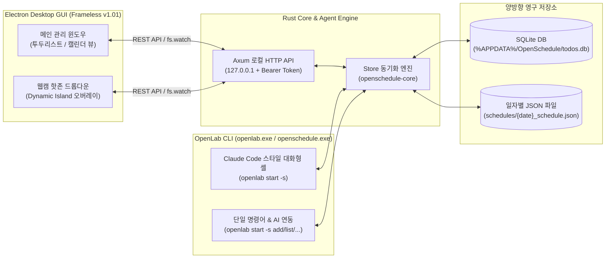

# OpenSchedule (OpenLab Schedule) v1.01

[](https://github.com/ksh6940/Open-Schdule)
[](./LICENSE)
[](https://www.rust-lang.org/)
[](https://www.electronjs.org/)

**OpenSchedule (OpenLab Schedule)** 은 **Apple Design System (Liquid Glass & HIG)** 기반의 프레임리스 데스크톱 일정·투두 관리 프로그램과 **상단 웹캠 핫존 드롭다운 오버레이**, 그리고 **Claude Code 스타일의 대화형 터미널 CLI (`openlab`)** 를 결합한 하이브리드 오픈소스 스케줄러입니다.

모든 일정 데이터는 **SQLite (`rusqlite`)** 데이터베이스와 로컬 **`schedules/{date}_schedule.json`** 파일에 실시간 양방향으로 저장·동기화되어, GUI 앱·터미널 CLI·외부 AI 에이전트(Claude Code, Cursor, Antigravity 등) 어디서든 끊김 없이 일정을 관리할 수 있습니다.

---

## ✨ 주요 특징 (v1.01)

### 1. 프레임리스 Apple Design System UI & 업그레이드된 UX
- **Frameless Liquid Glass 크롬**: OS 기본 제목 표시줄과 메뉴 표시줄을 제거하고, 드래그 이동 영역과 커스텀 윈도우 컨트롤(최소화·최대화/복원·닫기)이 통합된 53px 상단 Liquid Glass 네비게이션 바를 제공합니다.
- **실시간 달성률 프로그레스 바**: 현재 선택된 목록이나 날짜의 할 일 완료율(`%`)과 진행 현황을 헤더에서 즉시 확인할 수 있습니다.
- **원클릭 빠른 입력 & 호버 퀵 액션**:
  - 인라인 입력창에서 `오늘`, `내일`, `+1주` 원클릭 날짜 칩과 시간을 지정해 `Enter` 키로 즉시 등록할 수 있습니다.
  - 각 일정 항목에 마우스를 올리면 **`[+1일 미루기]`**, **`[상태 순환 배지]`**, **`[즉시 삭제]`** 퀵 액션 버튼이 나타납니다.
- **플로팅 Liquid Glass 토스트 알림**: 일정 추가·완료·기한 변경·삭제·동기화 시 화면 하단에 부드러운 토스트 피드백이 표시됩니다.

### 2. `[투두리스트 | 캘린더 뷰]` 실시간 모드 전환
- **투두리스트 모드 (`Ctrl+1`)**:
  - **2x2 스마트 카드**: `오늘`, `예정`, `전체`, `완료됨` 실시간 카운트 필터
  - **내 목록 (카테고리)**: 커스텀 컬러 태그별 할 일 분류
  - **4단계 상태 관리**: `○ 진행예정 (planned)` ➔ `◐ 진행중 (in_progress)` ➔ `◑ 조건부완료 (conditional_done)` ➔ `● 완료 (done)`
  - **우측 세부 인스펙터 패널**: 제목, 메모, 기한 일자/시간, 카테고리, 조건부 완료 사유 상세 편집
- **월간 캘린더 뷰 모드 (`Ctrl+2`)**:
  - 월간 달력 그리드에서 각 날짜별 `완료/전체` 배지와 일정 제목 미리보기를 한눈에 파악합니다.
  - 날짜 셀 **클릭** 시 해당 일자(`schedules/YYYY-MM-DD_schedule.json`)의 일정을 즉시 조회·추가하며, 날짜 셀 **더블클릭** 시 해당 날짜가 자동 지정된 새 일정 모달이 열립니다.

### 3. 상단 웹캠 핫존 드롭다운 (Dynamic Island 오버레이)
- 화면 최상단 중앙(웹캠 영역)으로 마우스 커서를 이동하면 반투명 Liquid Glass 오버레이 카드가 슬라이드 다운됩니다.
- 작업 중인 창을 전환하지 않고도 오늘 할 일을 확인하고 체크하거나 새로운 할 일을 즉시 추가할 수 있습니다.

### 4. Claude Code 스타일 인터랙티브 CLI (`openlab start -s`)
- 터미널에서 `openlab start -s`를 입력하면 Claude Code 감성의 대화형 셸이 실행됩니다.
- 슬래시 명령어(`/cal`, `/list`, `/today`, `/add`, `/done`, `/status`, `/edit`, `/delete`, `/cat`, `/sync`, `/program`)와 **한국어 자연어 입력**(예: `내일 오후 2시 팀 주간 회의 #업무`)을 모두 지원합니다.

### 5. SQLite ⇄ `schedules/{date}_schedule.json` 양방향 자동 저장소
- 할 일을 추가·수정·삭제할 때마다 SQLite(`todos.db`)와 로컬 워크스페이스의 **`schedules/YYYY-MM-DD_schedule.json`** 파일이 동시에 자동 갱신됩니다.
- 외부 에디터나 AI 에이전트가 `{date}_schedule.json` 파일을 직접 생성·수정해도 파일 감시(`fs.watch`) 및 자동 병합 엔진이 이를 감지하여 앱 화면과 SQLite DB에 즉시 반영합니다.

---

## 🏗️ 시스템 아키텍처



---

## 🚀 시작하기 (설치 및 실행)

### 필수 요구 사항
- **Rust** (1.75 이상, `cargo`)
- **Node.js** (18 이상, `npm`)

### 1. 저장소 클론 및 패키지 설치

```powershell
git clone https://github.com/ksh6940/Open-Schdule.git
cd Open-Schdule

# Node.js 의존성 (Electron 및 아이콘) 설치
npm install

# Rust 릴리즈 바이너리 (.exe) 빌드
cargo build --release --workspace
```

### 2. 실행 방법

터미널 어디서나 `openlab` 명령어로 CLI와 GUI 프로그램을 실행할 수 있습니다.

```powershell
# 1) Claude Code 스타일 대화형 CLI 실행 (Windows에서는 새 콘솔 창)
openlab start -s

# 2) 프레임리스 Electron GUI 데스크톱 프로그램 실행
openlab start -s program

# 또는 npm 스크립트로 GUI 직접 실행
npm start
```

Windows에서 대화형 `openlab start -s`는 새 콘솔을 엽니다. 단일 명령과
파이프로 입력을 전달하는 대화형 실행은 기존 터미널에서 동작합니다.
프로그램의 X 버튼은 창을 트레이로 숨기며, 트레이 아이콘을 클릭하면 다시 열립니다.
완전히 종료하려면 상단 연결 상태 버튼 또는 트레이 메뉴의 **종료**를 누르세요.
프로그램이 직접 시작한 백그라운드 엔진은 함께 종료되며, 별도로 실행 중이던 엔진은 유지됩니다.

### 3. 빌드된 `.exe` 실행 파일 위치

`cargo build --release --workspace` 및 패키징 실행 시 다음 경로에 독립 실행 파일(`.exe`)이 생성됩니다:

| 실행 파일 경로 | 설명 |
|---|---|
| `dist/openlab.exe` (`target/release/openlab.exe`) | 메인 통합 런처 (`openlab start -s` CLI 및 `openlab start -s program` GUI 실행) |
| `dist/openschedule.exe` (`target/release/openschedule.exe`) | 독립 CLI 전용 실행 파일 |
| `dist/openschedule-agent.exe` (`target/release/openschedule-agent.exe`) | 백그라운드 로컬 HTTP API 서버 & 에이전트 엔진 |

---

## 💻 CLI 사용 가이드 (`openlab`)

### 1. 대화형 셸 모드 (`openlab start -s`)

```text
╭─── OpenLab Schedule v1.0.1 ──────────────────────────────────────────────╮
│                                                                          │
│  ✻ Welcome to OpenLab Schedule CLI!                                      │
│                                                                          │
│    /help 명령어 도움말 · /cal 캘린더 뷰 · /list 투두리스트 · /program GUI   │
│    자연어 입력 예: 내일 오후 2시 프로젝트 미팅 #업무                     │
│                                                                          │
│    storage: SQLite + {date}_schedule.json                                │
╰──────────────────────────────────────────────────────────────────────────╯
```

- **슬래시 명령어**:
  - `/cal [YYYY-MM]` : 월간 캘린더 및 일자별 일정 표시
  - `/list [today|scheduled|all|completed|YYYY-MM-DD]` : 투두리스트 조회
  - `/add <제목> [-d 날짜] [-t 시간] [-c 카테고리] [-m 메모]` : 새 일정 추가
  - `/done <ID>` : 일정 완료 처리
  - `/status <ID> <planned|in_progress|conditional_done|done>` : 상태 변경
  - `/edit <ID> [--title ..] [--date ..] [--time ..]` : 일정 수정
  - `/delete <ID>` : 일정 삭제
  - `/sync` : `schedules/{date}_schedule.json` ⇄ SQLite 수동 동기화
  - `/program` : Electron GUI 데스크톱 프로그램 즉시 실행

### 2. 단일 명령줄 실행 (AI 에이전트 & 스크립트 연동)

```powershell
# 새 일정 추가 (자동으로 schedules/{date}_schedule.json 생성 및 갱신)
openlab start -s add "팀 주간 회의" --date tomorrow --time 14:00 --category 업무 --memo "분기 목표 점검"

# 한국어 자연 날짜/시간 지정
openlab start -s add "저녁 유산소 운동" -d 오늘 -t "19:00" -c 건강

# 일정 조회 (테이블 출력 / AI 파싱용 JSON 출력)
openlab start -s list --filter today
openlab start -s list --date 2026-11-10
openlab start -s list --json

# 일정 상태 변경 / 수정 / 삭제
openlab start -s done 1
openlab start -s status 1 in_progress
openlab start -s edit 1 --title "수정된 회의" --date 2026-11-12 --time 15:30
openlab start -s delete 1
```

---

## ⌨️ GUI 단축키 모음

| 단축키 | 동작 |
|---|---|
| `Ctrl + N` | 새 일정 추가 모달 열기 |
| `Ctrl + 1` | **투두리스트 뷰**로 전환 |
| `Ctrl + 2` | **월간 캘린더 뷰**로 전환 |
| `Ctrl + S` | 세부사항 인스펙터 저장 또는 `schedules/{date}_schedule.json` 동기화 |
| `/` | 검색창 즉시 포커스 |
| `Esc` | 열려 있는 모달 또는 우측 인스펙터 패널 닫기 |
| **캘린더 날짜 더블클릭** | 해당 날짜가 자동 입력된 새 일정 추가 모달 열기 |

---

## 🗂️ 일자별 JSON 포맷 (`schedules/{date}_schedule.json`)

할 일이 존재하는 날짜마다 `schedules/YYYY-MM-DD_schedule.json` 파일이 자동으로 생성·관리됩니다:

```json
{
  "date": "2026-11-10",
  "updated_at": "2026-11-10 14:00:00",
  "total_count": 1,
  "completed_count": 0,
  "todos": [
    {
      "id": 1,
      "title": "팀 주간 회의",
      "memo": "분기 목표 점검",
      "due_date": "2026-11-10",
      "due_time": "14:00",
      "status": "planned",
      "status_label": "진행예정",
      "condition_note": "",
      "category_id": 2,
      "category_name": "업무",
      "category_color": "#FF9500",
      "created_at": "2026-11-10 09:00:00",
      "completed_at": null
    }
  ]
}
```

---

## 👥 기여자 (Contributors)

- **[ksh6940](https://github.com/ksh6940)** - 프로젝트 기획, 아키텍처 설계 및 리드 개발
- **Gemini (Google DeepMind Antigravity)** - 페어 프로그래밍, 프레임리스 Apple Design System 및 Rust 코어/API 구현

---

## 📄 라이선스 (License)

본 프로젝트는 **Apache License, Version 2.0** 라이선스 하에 배포됩니다. 자세한 내용은 [LICENSE](./LICENSE) 파일을 참고하세요.

```text
Copyright 2026 ksh6940, Gemini (Google DeepMind Antigravity), and OpenSchedule Contributors

Licensed under the Apache License, Version 2.0 (the "License");
you may not use this file except in compliance with the License.
You may obtain a copy of the License at

    http://www.apache.org/licenses/LICENSE-2.0
```
